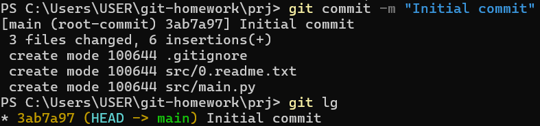
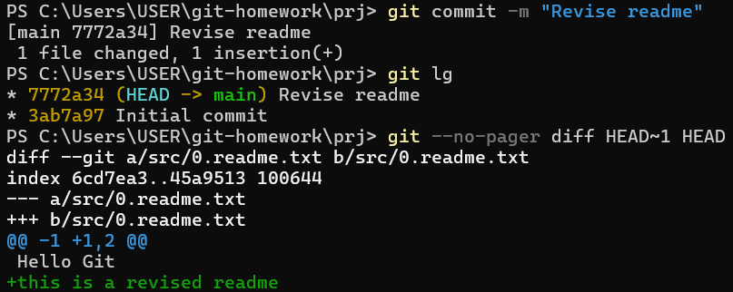
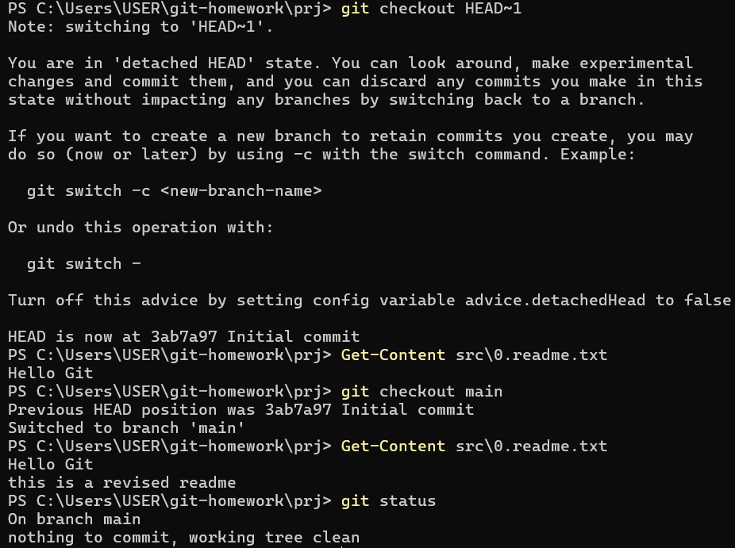
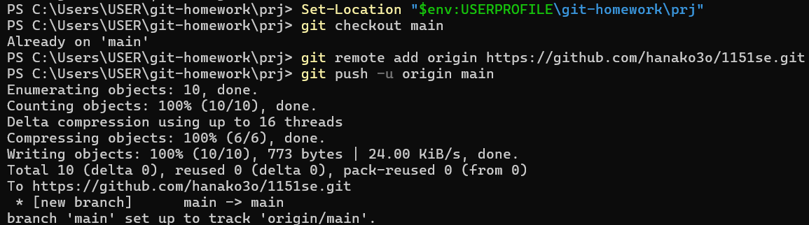
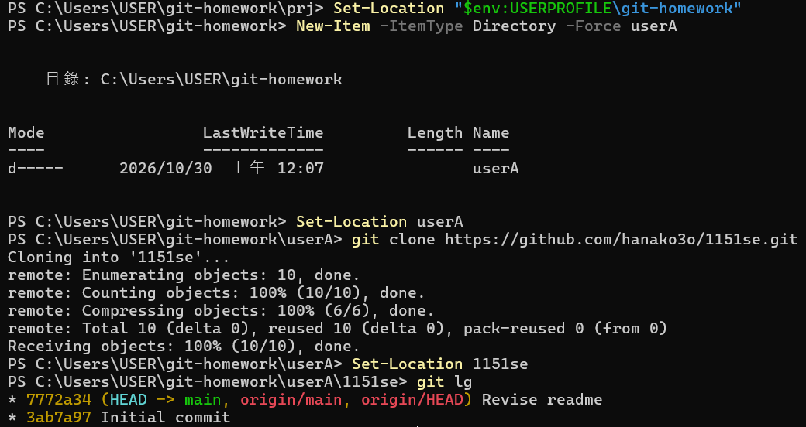
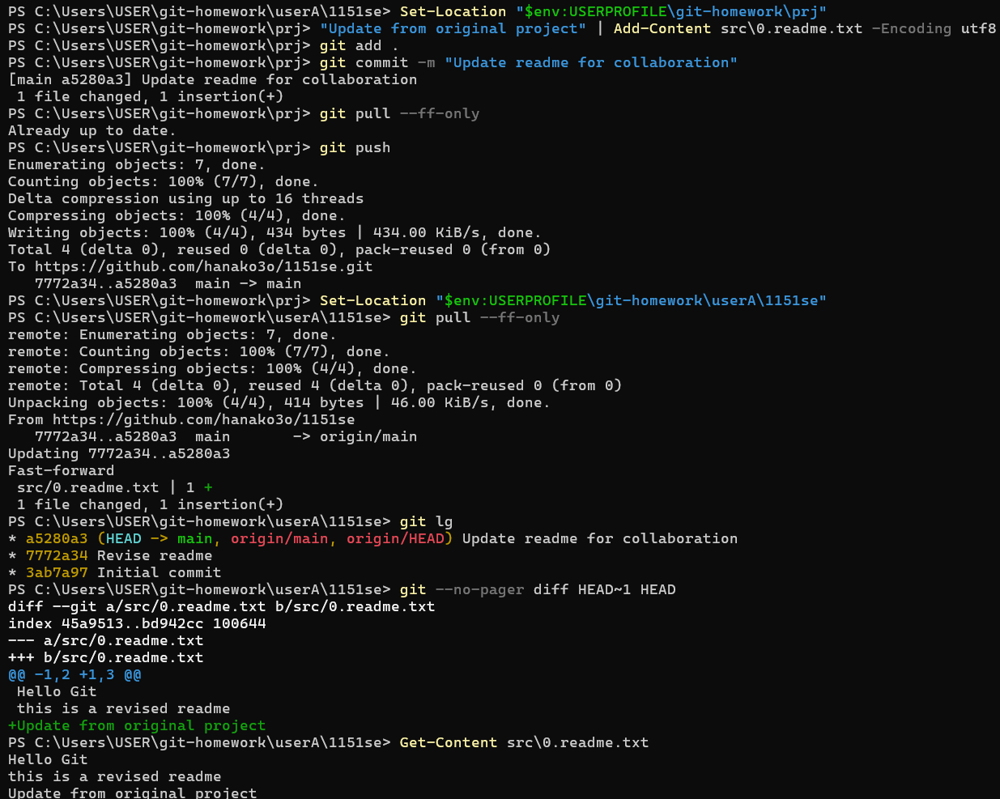
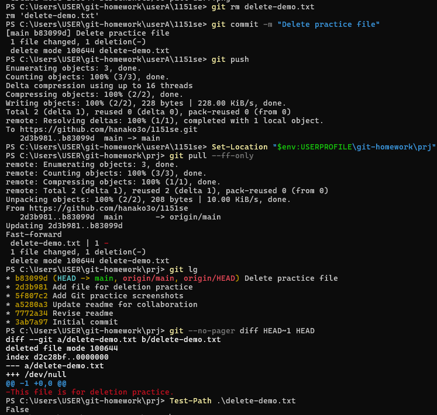

# Git 實作演練

本專案記錄 Git 本地版本控制與 GitHub 遠端協作演練。

## 演練內容

- 建立本地儲存庫與設定 .gitignore。
- 使用 add、commit 建立版本。
- 使用 log 查看歷程、diff 比較差異。
- 使用 checkout 切換版本。
- 使用 push 上傳至 GitHub。
- 使用 clone 建立 userA，模擬另一位使用者。
- 使用 pull 同步更新。
- 由 userA 刪除測試檔並推送，再由原專案拉取同步。

## 演練截圖

### 1. 第一次提交

### 2. 版本歷程與差異

### 3. 切換版本

### 4. 推送至 GitHub

### 5. 複製專案

### 6. 拉取更新與比較差異

### 7. 刪除檔案與同步

